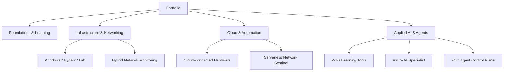
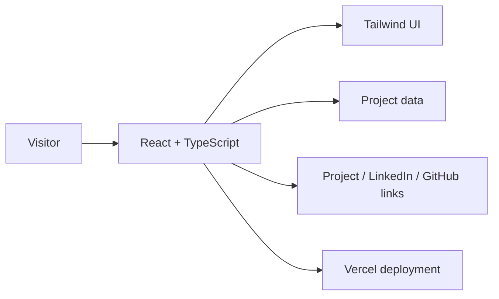

# Vahid Rahmani — Cloud & Infrastructure Portfolio

> Hands-on portfolio documenting my development across IT infrastructure, networking, cloud, automation and applied AI.

<p align="center">
  <a href="https://vahid-portfolio-three.vercel.app/">Live portfolio</a> ·
  <a href="https://www.linkedin.com/in/vahid-rahmani-699944417/">LinkedIn</a> ·
  <a href="https://github.com/Vahid-Rahmani">GitHub</a>
</p>

## What this portfolio communicates

This portfolio connects practical labs, monitoring tools, automation experiments and learning products. It is designed to show the progression from foundational practice to increasingly complex infrastructure and software projects. Each project should state its actual status and link to implementation evidence.

## Focus areas

| Area | Evidence in the project collection |
| --- | --- |
| Cloud & infrastructure | Azure concepts, infrastructure as code, deployment and monitoring |
| Systems administration | Windows Server, Active Directory, PowerShell remoting and Linux |
| Networking | Hyper-V, EVE-NG, SoftEther, VLANs, routing and hybrid connectivity |
| Automation | Python utilities, repeatable workflows, data collection and operational tooling |
| Applied AI | RAG/data pipelines, evaluation, LLM integrations and multi-agent workflows |
| Web delivery | React, TypeScript, Vite, Tailwind CSS and Vercel deployment |

## Project map



## Selected projects

### Infrastructure and networking

- [Windows Server, Hyper-V, EVE-NG and SoftEther Lab](https://github.com/Vahid-Rahmani/windows-hyperv-eve-softether-network-lab) — documented progression from a small virtual networking lab to a two-site environment with VLANs, Active Directory, shared storage and clustering.
- [Automated Hybrid Network Monitoring Dashboard](https://github.com/Vahid-Rahmani/Automated-Hybrid-Network-Monitoring-Dashboard) — Active Directory discovery, reachability checks, Windows host metrics and a FastAPI dashboard.
- [Hybrid Identity Sync — Local AD to Azure Entra ID](https://github.com/Vahid-Rahmani/Hybrid-Identity-Sync-Local-AD-to-Azure-Entra-ID) — repository for hybrid identity learning and implementation.
- [Network-to-Cloud Sheets](https://github.com/Vahid-Rahmani/network-to-cloud-sheets) — network and cloud learning project.

### Cloud and automation

- [Cloud & DevOps Hub](https://github.com/Vahid-Rahmani/cloud-devops-hub) — index of cloud and infrastructure projects.
- [Global High Availability Web Hosting with IaC](https://github.com/Vahid-Rahmani/Global-High-Availability-Web-Hosting-with-IaC) — infrastructure-as-code hosting project.
- [Cloud-connected Hardware & IoT Monitor](https://github.com/Vahid-Rahmani/Cloud-Connected-Hardware-IoT-Monitor) — hardware telemetry and cloud-connected monitoring concepts.
- [Serverless Network Sentinel Bot](https://github.com/Vahid-Rahmani/Serverless-Network-Sentinel-Bot) — network monitoring and automation project.

### Applied AI and learning products

- [Zova](https://github.com/Vahid-Rahmani/zofa) — AI-supported learning and classroom assistance.
- [Zova browser extension](https://github.com/Vahid-Rahmani/dobzova) — classroom assistance extension.
- [Zova product website](https://github.com/Vahid-Rahmani/zovasite) — product website source.
- [Azure AI Specialist Project Plan](https://github.com/Vahid-Rahmani/Azure-AI-Specialist-Project-Plan) — separate Azure-focused AI research and evaluation project.
- [AI Drop Agent](https://github.com/Vahid-Rahmani/AI-Drop-Agent) — automation project.

### Multi-agent systems

- [MultiAgentCoding](https://github.com/Vahid-Rahmani/mullti_agent_coding) — visual multi-agent coding workflow project.
- [Kontorit Agent Control Plane — FCC](https://github.com/Vahid-Rahmani/Kontorit-Agent-Control-Plane) — FCC agent runtime and control-plane workspace. This is separate from the KONTORIT public website and the Azure AI Specialist project.

## Site architecture



The portfolio is a Vite-powered React application. Project content is kept in the source data layer so it can be reviewed and updated without scattering project details across UI components.

## Local development

Requirements: Node.js and pnpm.

```bash
pnpm install
pnpm dev
pnpm build
```

The production build is emitted to `dist/` and is configured for Vercel deployment. German pages retain their existing URLs; English pages use `/en` and `/en/project/:slug`. The language switch preserves the current page. Titles, descriptions, canonicals, reciprocal hreflang, social cards and JSON-LD are managed in `src/lib/seo.ts`; FAQ content is shared through `src/data/faq.ts`.

The build generates a sitemap covering public projects in both languages, an optional `llms.txt` project index, a profile image and a `404.html`. The sample `/costs` dashboard is marked `noindex` and excluded from the sitemap. Search indexing and rankings are not guaranteed.

Run `pnpm exec tsc -p tsconfig.app.json --noEmit` and `pnpm build` to validate changes. After deployment, submit `https://vahid-portfolio-three.vercel.app/sitemap.xml` in Search Console.

## Professional profile

I am a Cloud Engineer trainee and IT infrastructure practitioner in Hamburg, Germany. My current learning and project work focuses on Azure, Windows Server, Linux, networking, Python, PowerShell and practical automation.

This portfolio is a record of learning and implementation. It distinguishes working features from prototypes, research and planned work. It does not claim a university degree or an unverified professional certification.

## Links

- [Live portfolio](https://vahid-portfolio-three.vercel.app/)
- [LinkedIn](https://www.linkedin.com/in/vahid-rahmani-699944417/)
- [GitHub](https://github.com/Vahid-Rahmani)
